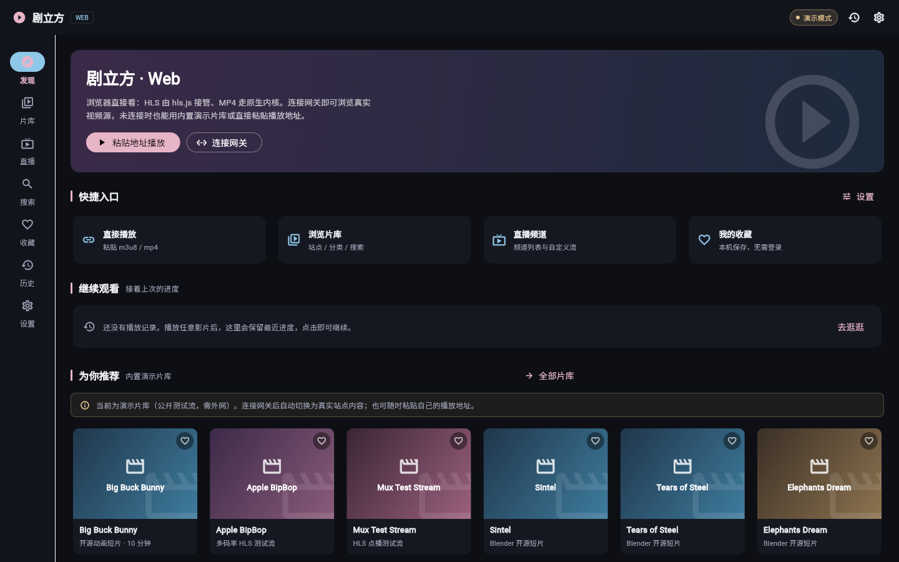
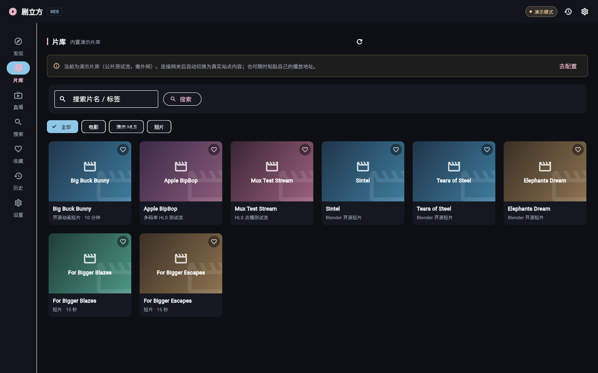
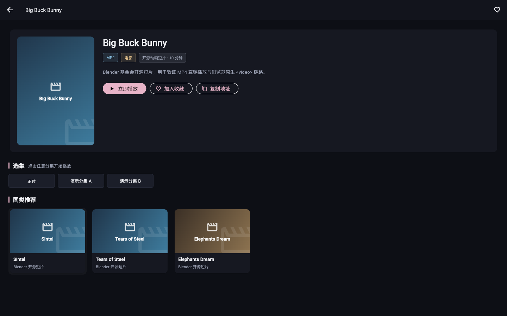
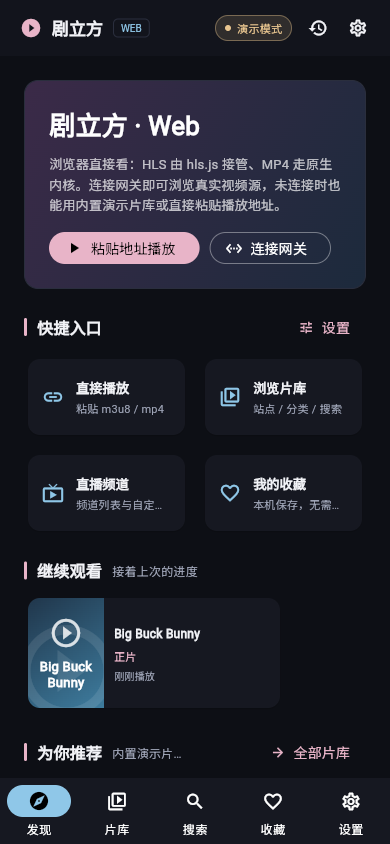
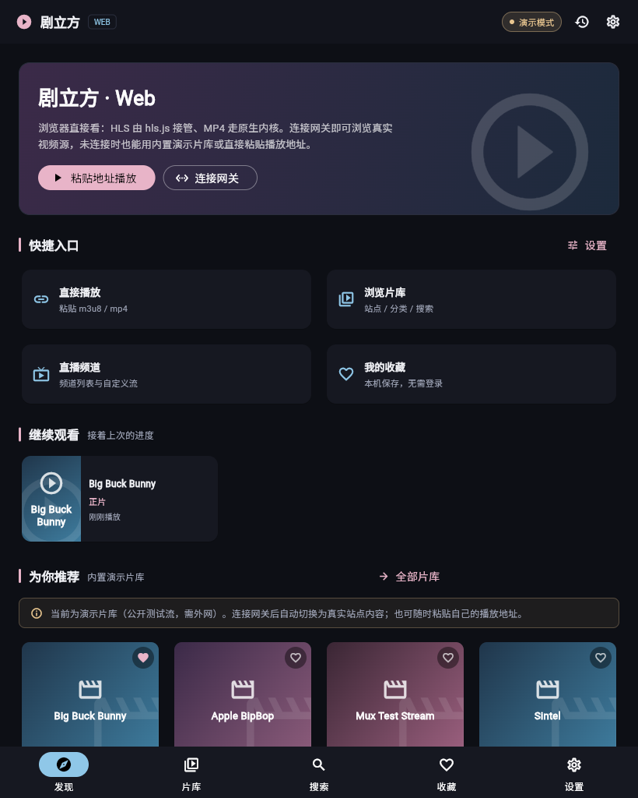

# 剧立方 DramaCube — Flutter Web 部署（路线 B）

> 完整 Web 应用：原生浏览器体验，nginx 静态托管 Flutter Web 产物，镜像实测 **126MB**。
> 纯内网可跑：字体、hls.js、演示视频流全部随镜像内置，页面 **0 外部请求**。
> 替代已废弃的路线 A（noVNC 桌面镜像，见 [DramaCube-releases](https://github.com/g-star1024/DramaCube-releases)）。

本仓库根目录**只是一个部署壳**：不含任何 Flutter 应用源码，仅负责把 Flutter Web 构建产物用 nginx 托管成镜像。
**`web/` 子目录**是独立的新一代 Web 前端（Next.js 14，详见 [web/README.md](web/README.md)）——与 Flutter 源码零耦合，仅只读复用网关契约与离线演示流。

---

## 架构（为什么不会互相影响）

| 仓库 | 性质 | 职责 |
|------|------|------|
| `hongguo-desktop`（私有） | 私有源码仓 | **唯一的应用源码**：Mac 原生 + Android + Web 共用同一套 `lib/`。Web 只是 `flutter build web` 这个编译目标，不是独立代码库。播放层用 `kIsWeb`/条件导入隔离——Web 用 `video` + `hls.js`，桌面仍是 media_kit/libmpv，**互不影响** |
| `DramaCube-releases`（公开） | 桌面发版 | 五平台桌面二进制发版 + 落地页（路线 A 已删除） |
| **`dramaCube-docker`（本仓，公开）** | **Web 部署壳 + 独立 Web 前端** | 根目录仅 nginx 打包：`Dockerfile` / `nginx.conf` / CI（从 `hongguo-desktop` 拉 web 产物塞进 nginx），**不持有、不修改 Flutter 源码**；`web/` 子目录为独立 Next.js Web 前端源码 |

关键点：**Web 版与 Mac 原生版是同一套源码的两个编译目标**，所以不存在"三套代码互相冲突"。本仓只消费 `flutter build web` 的**产物**，从源头杜绝了分叉。

---

## 快速体验（拉镜像直接跑）

```bash
docker run -d --name dramacube-web -p 8080:80 \
  ghcr.io/g-star1024/dramacube-docker:latest
```

浏览器打开 **http://localhost:8080**（NAS 部署把 `localhost` 换成 NAS IP，端口自定）。
或用 Compose：`docker compose -f docker-compose.example.yml up -d`。

**功能范围（Q1 轻量版 = 浏览远程 + 浏览器内核播放）**：完整应用壳，共 7 个页面 ——

| 页面 | 内容 |
|------|------|
| 发现 | Hero 横幅、4 个快捷入口、继续观看、推荐海报墙 |
| 片库 | 站点切换 / 分类 / 搜索 / 分页 / 海报墙 |
| 直播 | 频道列表 + 自定义直播流（网关 `/api/live/*` 目前是占位实现，前端已做宽容接入） |
| 搜索 | 演示片库 + 已连接网关最多 6 个站点，含最近搜索词 |
| 收藏 | 本地收藏，海报墙上直接点心形增删 |
| 历史 | 最近播放（保留片名 / 分集 / 播放地址，一键继续观看） |
| 设置 | 网关地址（保存 + 测试连接）、订阅导入、演示模式开关、清除本地数据 |

另有**影片详情页**（海报 / 简介 / 选集 / 同类推荐 / 收藏 / 复制地址）与**播放页**
（分集 / 倍速 / 全屏 / 收藏 / 历史记录）。收藏、历史、搜索词与网关地址存在浏览器
`localStorage`，无需登录、无后端。NAS 本地资源库、磁力下载、本地备份等桌面能力不在范围内。

**开箱即有内容**：未配网关时展示内置演示片库（纯本地静态数据 + 本地渐变封面，不依赖外链图片）。
**首条「离线演示片」是随镜像内置的 12 秒 HLS / MP4 测试流，纯内网就能真播放**，
可用来验证 hls.js 接管、分片加载、倍速与全屏；其余条目为公开测试流，真正播放需外网。
设置页可一键关闭演示模式（关闭后首页与片库都会清空）。配置网关后自动切换为真实站点内容；
网关直连需其带 `Access-Control-Allow-Origin: *`。Web 版自身不启动本地网关（浏览器不能监听端口）。

**离线 / 内网（本版已完全收口）**：

| 资源 | 处理方式 |
|------|----------|
| canvaskit | `--no-web-resources-cdn` → 产物内 `/canvaskit/...` |
| 中文字体 | 引擎 `fontFallbackBaseUrl` 指向 `fonts/fallback/`，103 个 woff2（Noto Sans SC 分片 + Roboto）随镜像内置（2.4MB）；清单外语言由 nginx 回落到通用分片，不产生 404 也不外联 |
| hls.js | `hls.min.js`（Apache-2.0）随源码仓 `web/` 进入产物，`hls_bridge.js` 加载失败时只回退原生播放，**不再回退 CDN** |
| 演示视频 | `demo/stream.m3u8` + 6 个 `.ts` 分片 + `demo/clip.mp4`，同源相对路径，nginx 对 HLS 不缓存 |
| Service Worker | 产物不再注册 SW；`index.html` 会主动注销旧版本残留的注册并清缓存，避免镜像升级后浏览器一直拿旧 `main.dart.js` |

实测：页面加载的字体请求全部命中本地 `200`，`fonts.gstatic.com` / `cdn.jsdelivr.net` /
`storage.googleapis.com` 等外部域名 **0 请求**，控制台 0 错误 0 警告。

**网关同源反代（可选，解决 HTTPS 混合内容）**：若页面走 HTTPS，直连 `http://<网关IP>:8787`
会被浏览器拦截。此时启动镜像时指定网关地址，并在设置页把「网关地址」填成 `/`：

```bash
docker run -d --name dramacube-web -p 8080:80 \
  -e GATEWAY_URL=http://192.168.1.10:8787 \
  ghcr.io/g-star1024/dramacube-docker:latest
```

Web 端请求同源 `/api/*`，由容器内 nginx 转发（路径原样保留，已实测），
因此不依赖网关 CORS、也不受混合内容限制。`GATEWAY_URL` 用变量 + `resolver` 在**运行时**解析，
网关容器尚未启动时 Web 容器仍可正常打开（仅 `/api/*` 返回 502，前端明确提示连接失败），
不会因 `[emerg] host not found in upstream` 直接退出。推荐填 IP 或 compose 服务名。

### 界面预览（真实浏览器渲染）

| 桌面首页 | 片库 | 详情页 | 手机 390px | 平板 820px |
|---|---|---|---|---|
|  |  |  |  |  |

宽屏（≥900px）用左侧导航栏，窄屏用底部导航栏；四向统一 24px 内边距。播放页截图见 [docs/web-player.png](docs/web-player.png)。

---

## 本地构建（开发调试）

需本机已装 Flutter + Docker，且能访问私有源码仓 `hongguo-desktop`。注意它是**单体仓**，真正的 Flutter 工程在 `apps/flutter/` 子目录：

```bash
# 默认即指向 ../hongguo-desktop/apps/flutter，可直接运行：
./build.sh
# 或显式传 Flutter 工程路径：
./build.sh /path/to/hongguo-desktop/apps/flutter
# 构建后运行：docker run -p 8080:80 dramacube-web:local
```

`build.sh` 在**临时副本**上构建，源码仓 `pubspec.yaml` 零改动：

1. 用 Web 专用入口 `lib/main_web.dart`（不 import 桌面 `app/router.dart`，磁力下载的 `dart:ffi` 不进编译图）
2. Q2：`scripts/prepare_web_pubspec.py` 临时移除 21 个桌面专属依赖；失败自动回退原始 pubspec
3. `flutter build web --release -t lib/main_web.dart --no-wasm-dry-run --no-web-resources-cdn`
4. 复制产物 → `scripts/prepare_web_output.py` 离线化收口（本地字体 / 注销 SW / 精简
   dart2js 用不到的 skwasm 与 symbols / 校验 hls.min.js）→ `docker build`

`prepare_web_output.py` 与 CI 调用的是**同一个脚本**，且离线资源全部来自本仓 `vendor/`
（`font-fallback.tar.gz` + `hls.min.js` 兜底），构建过程不访问任何 CDN。
如需在升级 Flutter SDK 后重建字体包，运行 `python3 scripts/fetch_font_fallbacks.py`。

本机 Flutter SDK 未加入 PATH 时会自动探测 `~/development/flutter/bin` 等常见位置。

---

## CI 自动构建镜像

触发：**Actions → build-web-image → Run workflow**，可填：

- `version`：版本号（如 `2.7.83`），用于镜像 `:vX.Y.Z`；留空只推 `:latest`
- `source_ref`：私有源码仓的 ref（默认 `feat/web-compat`；该分支含 Web 专用入口，尚未合回 `main`，合回后改为 `main`）

### 必须配置的 Secret

CI 需要读取私有源码仓 `hongguo-desktop`，请在本仓 **Settings → Secrets → Actions** 添加：

- `SOURCE_TOKEN`：一个具有 `repo`（读取私有仓）权限的 GitHub Personal Access Token

（公共仓 Actions 免费；用 PAT checkout 私有源码，构建完产物不入库。）
未配置时 CI 会在第一步直接给出 `::error::` 明确指引，不会出现含义模糊的 404。

---

## 关于播放（video + hls.js）

Web 端的 HLS/视频播放使用浏览器原生 `<video>` + [hls.js](https://github.com/video-dev/hls.js)。
本仓已把 `hls.min.js` 预置到 web 产物根目录（`/hls.min.js`），供 Web 播放层按需加载。

播放层接线在源码仓 `hongguo-desktop` 的 **Web 专用入口分支**（`lib/main_web.dart` +
`lib/features/web_player/` + `web/hls_bridge.js`），桌面原有 `.dart` 一个字未改，
media_kit/libmpv 行为完全不受影响。播放桥另提供 `dcSetRate` / `dcToggleFullscreen` /
`dcPlayerState`，供播放页的倍速、全屏与状态读取使用。
`hls_bridge.js` 中 **HLS 一律优先交给 hls.js**（只有 `Hls.isSupported()` 为 false 的
Safari 原生 HLS 或加载失败才走原生）——不能用 `canPlayType` 判断，Chrome 会返回误导性的 `"maybe"`。

> `SOURCE_TOKEN` 配置详见 [docs/SOURCE_TOKEN.md](docs/SOURCE_TOKEN.md)；
> 源码侧改造与实测记录详见 [docs/WEB_COMPAT_PLAN.md](docs/WEB_COMPAT_PLAN.md)。

---

## 前置条件（源码侧）

`flutter build web` 使用 `hongguo-desktop` 的 `feat/web-compat` 分支（含 Web 专用入口
`lib/main_web.dart`）。**不需要**改动桌面模块、也不需要给 `dart:io` 逐文件加条件导入——
实测编译错误只来自 import 链中的 `dart:ffi`，切断编译图即可。详见改造文档。

---

## 镜像体积

基底 `nginx:alpine` ≈ 40MB，叠加 Flutter Web 产物（canvaskit / main.dart.js / assets / hls.js）
后**实测 126MB**，远低于已废弃的路线 A noVNC 桌面镜像。入口文件 `no-cache`、
带 hash 资源 `immutable`，保证升级后浏览器不会拿到旧文件。
